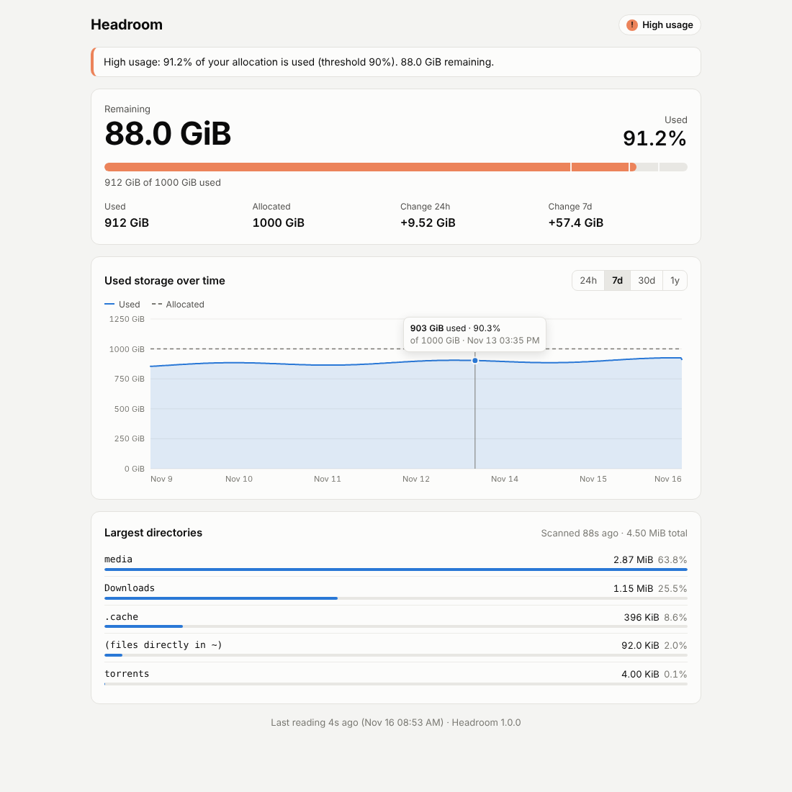

# Headroom

A lightweight, self-hosted storage monitor for Ultra.cc seedboxes. It shows how
much of your allocation you have used and how much is left, how usage has
changed over time, and which directories use the most space.

- Reads your allocation with `quota -s`, not `df`. On Ultra.cc, `df` reports
  the whole shared server disk.
- Shows remaining space, percentage used, used space and allocated space.
- Shows the change over the last 24 hours and 7 days.
- Keeps every reading in SQLite and plots usage over 24h, 7d, 30d or 1y.
- Raises a warning at 80%, 90% and 95% by default. You can change the
  thresholds.
- Lists the largest folders in your home directory. Click a folder to see
  what's inside it, down to 4 levels deep. One low-priority `du` scan every
  6 hours collects all levels at once.
- Runs without root or Docker. It needs only Flask and Waitress, and keeps all
  its files in your home directory.
- Runs as a user-level systemd service. It can sit behind Ultra.cc's Nginx at a
  base URL you choose, and can require a password.



## Quick start (Ultra.cc)

```bash
cd ~ && git clone https://github.com/chainzster/headroom.git && cd headroom
app-ports free                 # pick a port from YOUR assigned range (or check the UCP)
bash install.sh 12345 /headroom   # port, base URL
# install.sh finishes by printing the exact command to install the Nginx proxy file
app-nginx restart
```

Then open `https://<username>.<hostname>.usbx.me/headroom/` (keep the trailing slash).

For the full instructions, including manual install, password setup, updating
and uninstalling, see **[docs/INSTALL-ULTRACC.md](docs/INSTALL-ULTRACC.md)**.

## Requirements

- Python 3.8 or newer
- The `quota` command (installed on Ultra.cc)
- `du` from GNU coreutils, for the directory report
- An HTTP port from your Ultra.cc port range

## Configuration

The config file is at `~/.config/headroom/config.ini` and is created from
[`config.example.ini`](config.example.ini). You can point Headroom at another
file with `--config` or the `HEADROOM_CONFIG` environment variable. Restart the
service after changing it: `systemctl --user restart headroom`.

| Section | Key | Default | Meaning |
|---|---|---|---|
| `server` | `host` | `127.0.0.1` | Address to listen on. Keep `127.0.0.1` when using the Nginx proxy. Use `0.0.0.0` to also allow direct access on the port. |
| | `port` | – | **Required.** A port from your Ultra.cc range. |
| | `base_url` | empty | URL path behind Nginx, e.g. `/headroom`. Must match the Nginx `location`. |
| `monitor` | `poll_interval` | `300` | Seconds between quota readings (at least 60). |
| | `retention_days` | `365` | How long readings are kept. |
| | `quota_command` | `quota -s` | Command that reports the quota. |
| | `filesystem` | empty | Which filesystem to report, if `quota` lists more than one. When empty, Headroom uses the one with the largest allocation. |
| `thresholds` | `warning` / `high` / `critical` | `80` / `90` / `95` | Percentages at which each warning level starts. Must be ascending. |
| `directories` | `enabled` | `true` | Turns the largest-directories report on or off. |
| | `path` | `~` | Directory whose sub-directories are measured. |
| | `scan_interval` | `21600` | Seconds between scans (at least 600). |
| | `timeout` | `1800` | Seconds before a scan is abandoned. |
| | `depth` | `4` | How many levels below `path` you can drill into (1–8). |
| | `top_n` | `15` | Folders shown per level. The rest are summed into one "smaller folders" row. |
| | `exclude` | empty | Comma-separated `du --exclude` patterns. |
| `storage` | `data_dir` | `~/.local/share/headroom` | Location of the SQLite database and log files. |
| `auth` | `username` / `password_hash` | empty | Optional HTTP Basic auth. Generate the hash with `--hash-password`. |

## Operation

```bash
# Service control (always use --user on Ultra.cc)
systemctl --user status headroom
systemctl --user restart headroom

# Check the config and read the quota once, without starting the server
~/headroom/.venv/bin/python -m headroom --check

# Logs
tail -f ~/.local/share/headroom/headroom.log
```

**Endpoints.** All paths are relative to `base_url`.

| Path | Purpose |
|---|---|
| `/` | Dashboard |
| `/api/status` | Latest reading, warning level, 24h and 7d change |
| `/api/history?range=24h\|7d\|30d\|1y` | Readings for the chart, reduced to at most about 400 points |
| `/api/directories?path=files/tv` | Largest sub-folders of a folder from the latest scan. `path` is relative to the scan root; omit it for the top level. |
| `/healthz` | Liveness check. Needs no login. |

**Backups.** All history is in `~/.local/share/headroom/headroom.db`. To back it
up while Headroom is running:
`sqlite3 headroom.db ".backup headroom-backup.db"`.

## How it works

- **Single process.** Waitress serves the web interface with 4 threads. One
  background thread runs `quota -s` every `poll_interval` seconds and writes
  the result to SQLite. Old readings are pruned once a day. With 5-minute
  polling, a year of history is about 105,000 rows, or a few MB.
- **Quota parsing.** Headroom reads the `space` and `quota` columns. If there
  is no soft quota, it uses `limit` instead. It handles filesystem names that
  wrap onto their own line, and the `*` marker that appears when you are over
  quota. `quota -s` rounds figures (for example `912G`), so the values shown
  are accurate to the unit `quota` prints.
- **Directory scan.** Headroom runs
  `nice -n 19 ionice -c 3 du -0 -x -B1 --max-depth=4 ~` in a second
  background thread, and stores every folder it reports. Drilling down only
  reads the database, so it never starts a new scan. `-x` keeps the scan on your home filesystem, so rclone or FUSE mounts
  are skipped. The scan uses the lowest CPU and I/O priority, which matters on a
  shared server. Results are saved, so a restart doesn't trigger a new scan
  unless one is due.
- **Base URL.** A small WSGI middleware moves the `base_url` prefix into
  `SCRIPT_NAME`. The page uses relative URLs. This means the same instance works
  both behind Nginx at `/headroom/` and directly at `http://host:port/`.
- **Front end.** The front end is one HTML page, about 300 lines of plain
  JavaScript and an inline SVG chart. It has no CDN or build step, refreshes
  every 60 seconds, and follows the system light or dark setting.

## Troubleshooting

| Symptom | Fix |
|---|---|
| "Could not read quota: quota command not found" | Run `which quota`. If it's in an unusual place, set `quota_command` to the full path. |
| "No quota is set for this user" | `quota -s` prints `none`. Contact Ultra.cc support. |
| Several filesystems listed, wrong one shown | Set `[monitor] filesystem` to the device name from `quota -s`. |
| `./install.sh: Permission denied` | The executable bit was lost (e.g. the files were copied over SFTP), or your home is mounted `noexec`. Run `bash install.sh` instead. |
| Login always fails | `password_hash` must be the whole line printed by `--hash-password`, including the `scrypt:32768:8:1$` prefix, with no quotes. |
| 502 Bad Gateway through Nginx | Check that the service is running and the port in `config.ini` matches the Nginx file. Then run `app-nginx restart`. |
| Page loads without styling, or API 404s | `base_url` doesn't match the Nginx `location`, or `proxy_pass` ends in `/`. |
| Directory scan times out | Increase `[directories] timeout`, or exclude large trees with `exclude`. |

## Development

```bash
python3 -m venv .venv && .venv/bin/pip install -r requirements.txt pytest
.venv/bin/python -m pytest
```

The tests use a fake `quota` script, so they run on any Linux machine.

## Project layout

```
headroom/            application package
  __main__.py        entry point (python -m headroom)
  app.py             Flask routes, base-URL middleware, auth
  config.py          INI config loading and validation
  quota.py           runs and parses `quota -s`
  diskusage.py       low-priority `du` scan
  monitor.py         background polling and scan threads
  storage.py         SQLite persistence
  templates/, static/  the dashboard
config.example.ini   annotated configuration
install.sh           Ultra.cc installer (venv, config, systemd unit)
deploy/              systemd unit and Nginx proxy example
docs/                Ultra.cc install guide and reference
tests/               pytest suite
```
